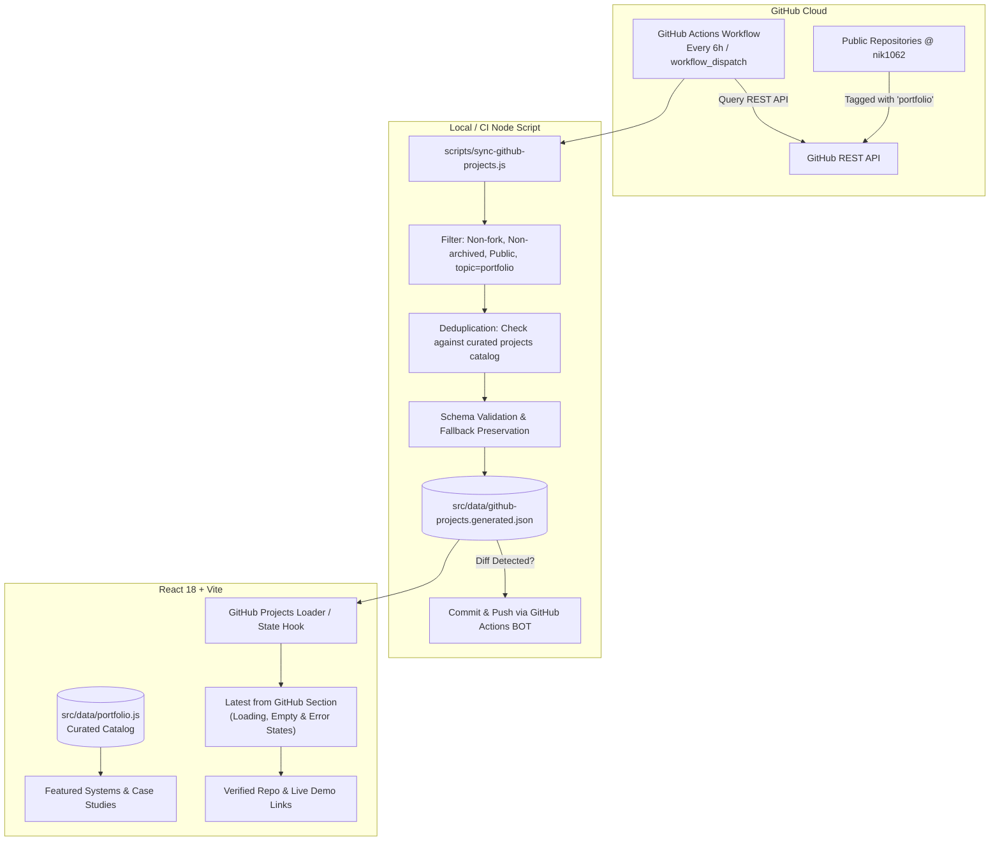

# GitHub-Powered Project Sync & UI Polish Architecture Specification

**Document Version:** 1.0.0  
**Status:** DRAFT — AWAITING USER APPROVAL  
**Target Author:** Nikunj Kumar (`nik1062`)  
**Design Aesthetic:** Obsidian & Gold Glassmorphic Editorial  

---

## 1. System Overview & Objective

The objective of this upgrade is two-fold:
1. **Part A (UI Polish):** Elevate the existing Obsidian & Gold portfolio UI with refined typography hierarchy, improved spacing and card polish, enhanced responsive layouts, subtle 3D interactions and hover effects, smooth transitions, and dedicated loading/empty states — without breaking existing routes, components, or themes.
2. **Part B (Automatic GitHub Project Sync):** Build an automated, unauthenticated GitHub-powered discovery pipeline. Whenever a public repository owned by `nik1062` is tagged with the GitHub topic `portfolio`, an automated GitHub Action will discover it, extract rich metadata, validate and de-duplicate it against curated projects, and update a local JSON data source (`src/data/github-projects.generated.json`). The portfolio will display these dynamically in a dedicated **"Latest from GitHub"** section.



---

## 2. Part A: UI Polish Specification

The existing Obsidian & Gold design will be polished while strictly preserving its visual identity (`#090909` base, `#f5a623` amber gold accent, glassmorphic top pill navigation, and sticky left profile rail):

1. **Typography Hierarchy:**
   - Standardize display headers using high-contrast scale: Eyebrow (`11px`, letter-spacing `+0.2em`, uppercase, gold), Headline (`clamp(2.5rem, 5vw, 4rem)`, line-height `1.05`, font-weight `800`), Subheadline (`clamp(1.1rem, 2vw, 1.35rem)`, line-height `1.55`, color `var(--muted)`).
   - Ensure clean vertical rhythm across all sections.

2. **Card Polish & Surfaces:**
   - Elevate `.project-card` with refined 1px borders (`rgba(255, 255, 255, 0.08)` rest, `rgba(245, 166, 35, 0.65)` active/hover).
   - Add dynamic specular spotlight glare on hover via `--mouse-x` and `--mouse-y` tracking.
   - Refine category badge pills with micro-borders and soft ambient glows.

3. **Responsive Spacing & Alignment:**
   - Optimize grid gaps and padding for mobile (`< 768px`), tablet (`768px - 1024px`), and desktop (`> 1024px`).
   - Fix any touch target boundaries to be at least `44px` on mobile.

4. **Smooth Transitions & Feedback:**
   - Framer Motion layout animations on project filters for zero-flicker category switching.
   - Elegant skeleton loaders when projects are loading.
   - High-fidelity empty state when no projects match a filter.

---

## 3. Part B: GitHub Synchronization Architecture

### 3.1 Unauthenticated GitHub REST API Integration
* **Endpoint:** `GET https://api.github.com/users/nik1062/repos?per_page=100&sort=updated`
* **Headers:** `Accept: application/vnd.github+json`, `User-Agent: nik1062-portfolio-sync`
* **Rate Limits:** Public unauthenticated requests allow up to 60 requests per hour. Since the sync workflow executes once every 6 hours and fetches a single page (up to 100 repositories), it operates well within limits. In GitHub Actions, `secrets.GITHUB_TOKEN` is automatically provided by the runner and grants 1,000+ requests/hour without requiring personal access tokens.
* **Security Rule:** **Never** expose GitHub credentials, personal tokens, or private repository data in Vite environment variables or frontend bundles.

### 3.2 Filtering & Qualification Rules
A repository will be included in `github-projects.generated.json` **only** if:
1. `fork === false` (excludes forks).
2. `archived === false` (excludes archived/read-only code).
3. `visibility === 'public'` (or `private === false`).
4. `topics` array includes `"portfolio"` (case-insensitive check).
5. Repository name is not in the configuration exclusion list (`excludedRepositories`).

### 3.3 Data Schema (`src/data/github-projects.generated.json`)
```json
{
  "lastSynced": "2026-11-27T15:45:00.000Z",
  "username": "nik1062",
  "topic": "portfolio",
  "totalDiscovered": 1,
  "projects": [
    {
      "id": 123456789,
      "name": "ai-memory-agent",
      "displayName": "AI Memory Agent",
      "description": "Persistent memory and cognitive retrieval pipeline using vector embeddings.",
      "htmlUrl": "https://github.com/nik1062/ai-memory-agent",
      "homepage": "https://ai-memory-agent.vercel.app",
      "language": "TypeScript",
      "topics": ["portfolio", "ai", "vector-search"],
      "stars": 12,
      "forks": 2,
      "openIssues": 0,
      "createdAt": "2026-08-10T10:00:00Z",
      "updatedAt": "2026-11-25T14:30:00Z",
      "pushedAt": "2026-11-25T14:30:00Z",
      "license": "MIT"
    }
  ]
}
```

### 3.4 Preservation of Curated Projects & De-duplication Strategy
* **Curated Projects Catalog:** All 12 curated projects in `src/data/portfolio.js` remain completely untouched, retaining their custom problem statements, architectural decisions, and visual themes.
* **De-duplication Check:**
  Before adding any discovered GitHub repository to the "Latest from GitHub" section, the system performs a normalized comparison against curated projects:
  ```javascript
  function isAlreadyCurated(githubRepo, curatedProjects) {
    const repoUrl = (githubRepo.htmlUrl || "").toLowerCase().trim();
    const repoName = (githubRepo.name || "").toLowerCase().replace(/[-_]/g, "");
    
    return curatedProjects.some(curated => {
      const curatedUrl = (curated.repo || "").toLowerCase().trim();
      const curatedSlug = (curated.slug || "").toLowerCase().replace(/[-_]/g, "");
      return (curatedUrl && curatedUrl === repoUrl) || (curatedSlug && curatedSlug.includes(repoName));
    });
  }
  ```
  If a repository is already curated in `portfolio.js`, it is retained in the curated showcase and not duplicated in the GitHub feed.

---

## 4. GitHub Actions Automation Workflow

File: `.github/workflows/sync-portfolio-repos.yml`
* **Triggers:**
  - Scheduled cron: `0 */6 * * *` (Every 6 hours)
  - Manual trigger: `workflow_dispatch` (On-demand execution with a single click in GitHub UI)
* **Execution Flow:**
  1. Check out repository with actions/checkout.
  2. Set up Node.js LTS environment.
  3. Execute `node scripts/sync-github-projects.js`.
  4. Check if `src/data/github-projects.generated.json` has git diffs.
  5. If changed: Commit with message `"chore(data): auto-sync latest GitHub repositories with 'portfolio' topic [skip ci]"` and push back to branch.
  6. If unchanged: Log `"No updates detected. Generated data is in sync."` and exit cleanly.

---

## 5. UI Presentation: "Latest from GitHub"

A dedicated section will be integrated into both the **Home Page** and the **Projects Page**:
* **Section Header:**
  - Eyebrow: `LIVE TELEMETRY // GITHUB AUTOMATION`
  - Title: `Latest from GitHub`
  - Subtitle: `Public repositories tagged with #portfolio on GitHub, synchronized automatically.`
* **Card Display (`GitHubProjectCard`):**
  - Repository name with GitHub icon.
  - Formatted relative update date (e.g., `Updated 2 days ago`).
  - Star count badge (e.g., `★ 14`).
  - Primary language pill with colored dot indicator (TypeScript, Python, JavaScript, Dart, etc.).
  - Topics list (`portfolio`, `react`, `docker`, etc.).
  - Direct repository link + live demo link (if `homepage` exists).
* **States:**
  - **Loading State:** 3 pulsing skeleton cards matching the Obsidian/Gold theme.
  - **Empty State:** Clean, friendly placeholder card: *"No additional repositories tagged with #portfolio found. Tag any repository with 'portfolio' on GitHub to display it here automatically."*
  - **Error State:** Non-blocking notification card preserving the last successfully generated project data.

---

## 6. Admin Panel Enhancements

In `src/components/AdminPanel.jsx`:
- **Sync Telemetry Tile:** Shows timestamp of last successful sync, total discovered repositories, and active topic filter (`portfolio`).
- **Manual Sync Trigger Guide:** Explains how to trigger instant sync via GitHub Actions or local CLI (`npm run sync:github`).
- **Repository Exclusions:** View configured repository exclusions.

---

## 7. Reliability, Testing & Error Handling

A dedicated test suite `test/github-sync.test.js` will be created and run using Node.js's native test runner (`node --test`):
* **Test 1:** Verify exclusion of forked and archived repositories.
* **Test 2:** Verify requirement of the `portfolio` topic.
* **Test 3:** Verify deduplication logic against curated projects catalog.
* **Test 4:** Verify graceful error recovery on rate-limited or malformed API responses (preserving existing data without data loss).
* **Test 5:** Verify sorting by latest activity (`pushed_at` / `updated_at`).

---

## 8. Exact Files to be Created or Modified

### New Files to Create:
1. `scripts/sync-github-projects.js` — Standalone synchronization script for GitHub API fetching, filtering, and JSON generation.
2. `src/data/github-projects.generated.json` — Generated data source populated by the sync script.
3. `.github/workflows/sync-portfolio-repos.yml` — Automated GitHub Actions workflow running every 6 hours and on dispatch.
4. `src/components/GitHubProjectsSection.jsx` — Reusable "Latest from GitHub" section with loading, empty, and card states.
5. `test/github-sync.test.js` — Automated unit test suite verifying filtering, deduplication, and resilience.

### Existing Files to Update (with backups created beforehand):
1. `src/App.jsx` — Integrate `GitHubProjectsSection` into `HomePage` and `ProjectsPage`, add `npm run sync:github` script support, and refine UI transitions.
2. `src/styles.css` — Add polished styles for GitHub cards, language badges, skeleton loaders, and empty state containers while keeping Obsidian & Gold tokens.
3. `package.json` — Add `"sync:github": "node scripts/sync-github-projects.js"` and `"test": "node --test test/*.test.js"` scripts.
4. `src/components/AdminPanel.jsx` — Add sync status telemetry card.
